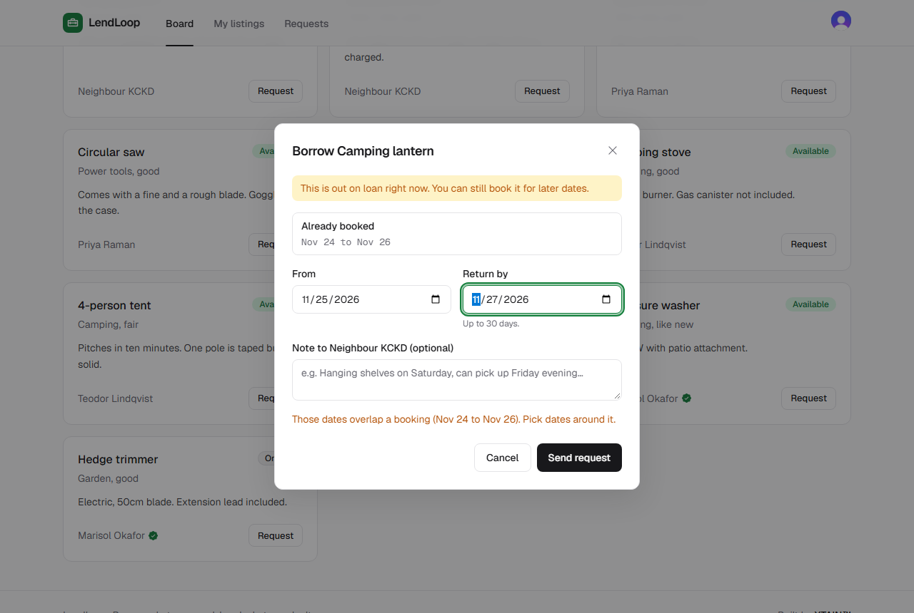
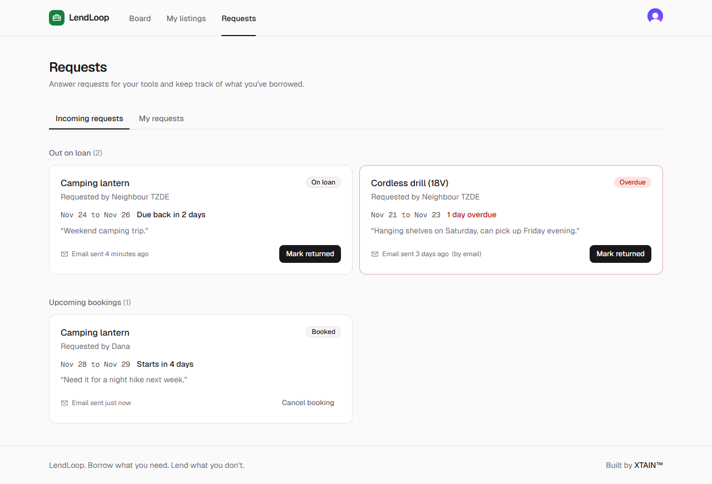
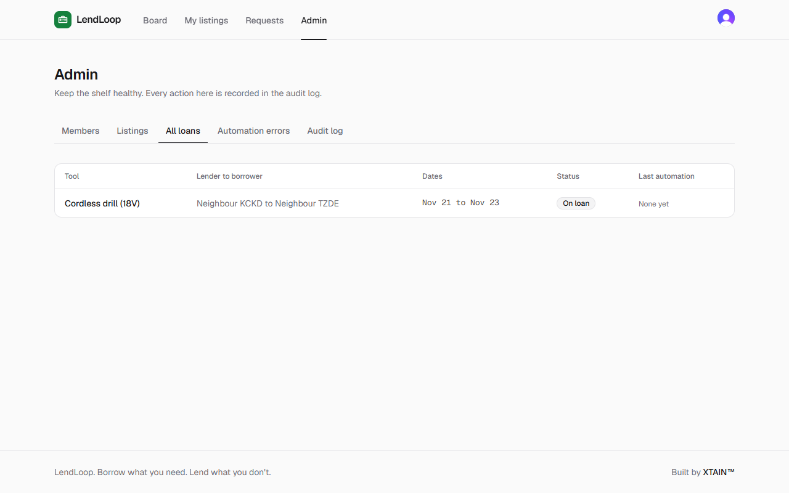
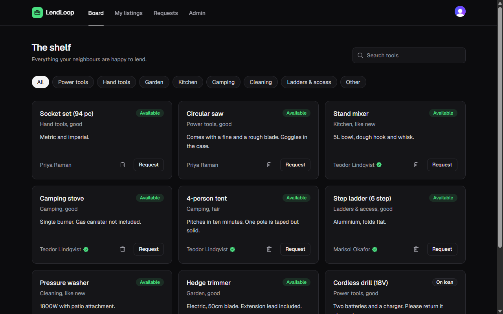
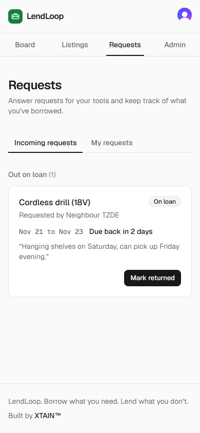
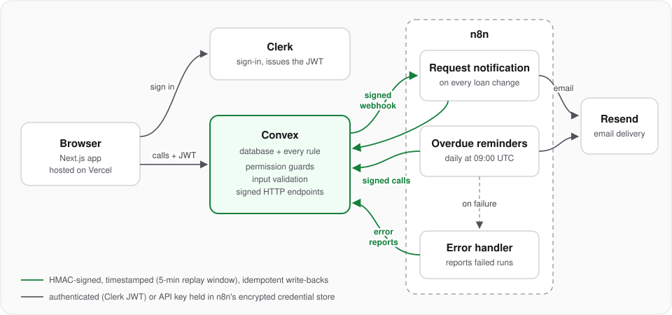
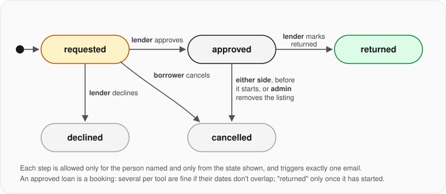

<div align="center">

# LendLoop

### Borrow what you need. Lend what you don't.

A neighbourhood tool-lending app where neighbours share the drills, ladders and tents they rarely use,<br/>
with automated email notifications and overdue reminders running in the background.

**[Live demo](https://lendloop-zeta.vercel.app)** · [How it works](#how-it-works-in-plain-language) · [Engineering highlights](#engineering-highlights) · [Architecture](#architecture) · [Run it locally](#run-it-locally)


</div>

---

### For reviewers: where each deliverable lives

| Deliverable | Where |
|---|---|
| App source code | This repository: [`src/`](src) (Next.js), [`convex/`](convex) (backend, permission rules, signed endpoints) |
| Exported n8n workflow JSON | [`n8n/workflows/`](n8n/workflows): request notification, overdue reminders, error handler |
| Local setup, including n8n (docker-compose) | [Run it locally](#run-it-locally) and [`docker-compose.yml`](docker-compose.yml) |
| Environment variables | [Environment variables](#environment-variables), plus [`.env.example`](.env.example) and [`n8n/.env.example`](n8n/.env.example) |
| Architecture | [Architecture](#architecture), [Automation design](#automation-design-n8n) |
| Security and data-minimisation decisions | [Security decisions](#security-decisions), [Data minimisation](#data-minimisation), [Roles and access control](#roles-and-access-control) |
| Production note | [What I would change for production](#what-i-would-change-for-production), plus [Known limitations and trade-offs](#known-limitations-and-trade-offs) |
| Bonus: automation activity on each loan | "Email sent / Reminder sent 2 days ago" on every loan ([tour](#3-requests-loans-and-bookings)) |

---

## The idea in one minute

Most households own tools that sit in a cupboard almost all year: a drill used twice, a ladder used once, a tent used for one festival. Meanwhile the neighbour two doors down is about to buy the same drill for one weekend job.

**LendLoop is a shared shelf for a street or neighbourhood.** People list the tools they're happy to lend. Anyone in the neighbourhood can browse what's available, ask to borrow something for specific dates, and the owner says yes or no. When a loan's return date passes, the borrower gets a friendly daily reminder until the tool is back.

What makes it more than a list:

- **It runs itself.** Every request, approval, decline or return automatically emails the right person, and overdue loans are chased every morning without anyone lifting a finger.
- **It's built for trust between strangers.** You only ever see a neighbour's display name, never their email. Admins can mark reliable people as **Trusted Lenders** and remove listings that shouldn't be there.
- **Nothing fails silently.** If an email can't be sent, the app records it and shows it to admins and on the loan itself.

---

## Try it

**Live demo: [https://lendloop-zeta.vercel.app](https://lendloop-zeta.vercel.app)**

You don't need a real email address. The demo uses Clerk's test mode:

1. Click **Sign in to lend or borrow**, then **Sign up**.
2. **Email:** any address ending in `+clerk_test@example.com`, for example `jane+clerk_test@example.com` (the `+clerk_test` part is what makes it a test account).
3. **Password:** choose your own, at least 8 characters (common passwords are rejected), for example `LendLoop-Demo-2026!`.
4. **Verification code:** when asked for one (at sign-up, or when signing in from a new device), enter **`424242`**. This is the code, not the password.

**What's on the board:**

- **Most tools are listed by me (Christian Tochukwu).** Request one and I'll approve it from my own account. My requests inbox is emailed to me, and you'll see the status change to "On loan" (or "Booked" for later dates) on your side.
- **Two tools belong to demo neighbours** (Marisol's hedge trimmer and Teodor's tent). Their accounts can't sign in, so **requests on them stay pending**: a live demonstration that only a tool's owner can approve. Not even an admin can approve on someone else's behalf. Marisol's hedge trimmer also carries an overdue loan, so the reminder history is visible straight away.

**To see the full lending flow without waiting for me,** open a second browser (or a private window) and sign up as a second neighbour, for example `sam+clerk_test@example.com`. List a tool as one person, request it as the other, then approve it as the first.

> Emails are delivered by the n8n automation server. In this demo, outgoing email is redirected to the developer's inbox (the email provider is in test mode without a custom domain), so you'll see "Email sent just now" on the loan rather than an email in your own inbox. The n8n server is self-hosted for this demo; if it's offline, the app keeps working and undelivered notifications are retried, then listed under **Admin → Automation errors**.

---

## A tour of the app

### 1. The shelf

Signed-in neighbours see every tool with its availability, can filter by category or search, and request anything that isn't theirs. The green badge next to a name marks a **Trusted Lender**.


### 2. Asking to borrow

Pick the dates (up to 30 days) and add a short note for the owner. A tool can be **booked for later dates even while it's out on loan**: the form lists the dates that are already taken (dates only, never who took them) and warns straight away if your dates clash. The same rules are enforced again on the server, so they can't be bypassed.



### 3. Requests, loans and bookings

Owners answer requests; borrowers track what they've asked for. Items are grouped by what needs attention first: **waiting for an answer**, **out on loan** (with **"Due back in 2 days"** or **"1 day overdue"**), **upcoming bookings** (**"Starts in 4 days"**), then history. Either side can **cancel a booking before it starts**, after a confirmation, and the other person is emailed. The latest automation activity ("Email sent just now", "Reminder sent 2 days ago") appears on every loan.



### 4. My listings

List, edit or delete your own tools. A tool can't be deleted while it's out on loan; deleting one with only future bookings cancels them and tells each borrower.


### 5. Admin

Admins manage members (grant or revoke **Trusted Lender**), remove any listing, see every loan across the neighbourhood, and read an **audit log** of every admin action. Failed automation runs appear under **Automation errors** (with an open-count badge on the tab): a notification the backend couldn't deliver can be re-sent with **Retry now**, and any error can be **marked resolved** once handled.




### Works in dark mode and on phones

<p>

&nbsp;

</p>

---

## How it works, in plain language

```
 Neighbour A lists a drill
          │
 Neighbour B asks to borrow it (Sat to Mon) ──►  email to A: "B wants to borrow your drill"
          │
 A approves ─────────────────────────────────►  email to B: "Approved, please return it by Mon"
          │
 Monday passes, drill not back ──────────────►  every morning: reminder email to B
          │
 A marks it returned ────────────────────────►  email to B: "Returned, thanks!"   (reminders stop)
```

Meanwhile, neighbour C can **book the drill for the following weekend** while B still has it, as long as the dates don't overlap. The drill shows "On loan" only while a booking is actually running.

Behind the scenes there are three cooperating parts:

| Part | Role in one sentence |
|---|---|
| **The app** (Next.js) | What people see and click. |
| **The backend** (Convex) | Stores everything and enforces every rule: who can see what, and who may do what. |
| **The automation server** (n8n) | Sends the emails and runs the daily reminder job, talking to the backend over a signed, verified connection. |

---

## Engineering highlights

This project was built to production standards, not just to make the screens work. The parts that took the most care:

**1. Security rules live in the backend, not the buttons.** Hiding a button doesn't stop someone calling the API directly. Every backend function starts with a permission check (`requireUser`, `requireAdmin`, `requireOwnTool`, `requireLoanParty`) in one file, [`convex/lib/auth.ts`](convex/lib/auth.ts). The user's identity always comes from the verified login token, never from data the browser sends.

**2. A signed connection in both directions.** Every message between the backend and the automation server carries an **HMAC-SHA256 signature** and a timestamp. Forged, tampered or replayed (older than 5 minutes) messages are rejected. Each direction has its own secret, and secrets can be rotated without downtime.

**3. Retries can never send a duplicate.** Networks fail, so everything retries. Each email and each write-back carries a unique **idempotency key**, so a retry can't create a second reminder or a second record. This is enforced at three levels: the overdue query, the database write, and the email provider's own idempotency header.

**4. Failures are visible, and recoverable.** Failed deliveries retry with growing delays (30 s → 2 min → 10 min → 30 min). If something still fails, it's recorded and shown to admins in the app and on the affected loan, where an admin can **Retry now** once the cause is fixed (the error clears itself when the email goes through). A dedicated n8n **error workflow** catches anything else.

**5. Bookings that can't double-book.** Several people can book the same tool for different dates. The overlap check runs inside the same database transaction as the approval, so two overlapping approvals can't both succeed, even if two lenders' clicks race. An hourly backend job flips a tool to "On loan" when a booking's start date arrives.

**6. Privacy by default (data minimisation).** The public page shows only tool names and categories. Signed-in users see display names, never emails. The automation server receives only what each email needs. When someone has no name set, they get a neutral handle like "Neighbour K3F9" instead of part of their email. That last one was a bug I caught during browser testing, and a test now guards it.

**7. Tested, including the tests themselves.** 44 automated tests cover the permission rules, the bookings logic and the integration (signatures, replays, idempotency, retries, admin retry, payload contents). Key tests were **sabotage-checked**: I deliberately broke the rule under test and confirmed the test failed, so the suite is proven to catch real regressions. A live smoke-test script checks the deployed endpoints.

**8. Thoughtful, accessible UX.** Loading skeletons that match the final layout, empty states that tell you what to do next, human-readable errors with a next step, due-back and starts-in countdowns, confirmations before anything irreversible that emails someone, filters and tabs kept in the URL (shareable and Back-button friendly), dark mode, and a phone layout where no tab is hidden off-screen. The UI was audited against the [Web Interface Guidelines](https://github.com/vercel-labs/web-interface-guidelines) and fixed: visible focus rings, a skip link, decorative icons hidden from screen readers, unique button labels, named form fields, and `theme-color` for both themes.

---

## Architecture

<p align="center">

</p>

| Layer | Technology | Responsibility |
|---|---|---|
| Frontend | Next.js 15 (App Router), React 19, Tailwind v4, Motion | UI only. No API routes and no business logic in the browser |
| Auth | Clerk | Sign-in. Convex verifies Clerk's JWT on every call |
| Backend + DB | Convex | Data, permission checks, validation, scheduling, signed HTTP endpoints for n8n |
| Automation | n8n 2.48 | Emails, the daily reminder job, error reporting |
| Email | Resend | Delivery, with idempotency keys |

### The loan lifecycle

<p align="center">

</p>

Each transition is checked for **who** is acting (lender, borrower or admin) and for the **current state** (you can't approve a declined request, mark a booking returned before it starts, or cancel a loan that is already out). Every transition triggers exactly one notification.

An approved loan is a **booking**. A tool can hold several bookings as long as their dates don't overlap ([`convex/lib/bookings.ts`](convex/lib/bookings.ts)); its status is "On loan" only while a booking has started, recomputed after every change and by an hourly cron ([`convex/crons.ts`](convex/crons.ts)).

### Data model ([`convex/schema.ts`](convex/schema.ts))

| Table | Holds |
|---|---|
| `users` | Login identity, email, display name, role (`user`/`admin`), Trusted Lender flag |
| `tools` | Owner, name, category, condition, description, availability |
| `loans` | Tool (plus a name snapshot so history survives deletion), lender, borrower, dates, status; indexed by tool, by end date (overdue) and by start date (bookings starting) |
| `automationEvents` | Per-loan activity ("Email sent", "Reminder sent") with a unique idempotency key |
| `automationErrors` | Failed automation runs, visible to admins; backend delivery failures also keep the loan + event so they can be retried, and when they were retried or resolved |
| `auditLog` | Every admin action |

---

## Roles and access control

| Action | Guest | Neighbour | Admin |
|---|:-:|:-:|:-:|
| See available tools (name + category only) | ✅ | ✅ | ✅ |
| See the full board with availability | | ✅ | ✅ |
| List a tool / edit or delete **own** listings | | ✅ | ✅ |
| Request to borrow (not your own tool) | | ✅ | ✅ |
| Approve / decline / mark returned on **own** tools | | ✅ | ✅ |
| Cancel **own** pending request | | ✅ | ✅ |
| Cancel a booking **you're part of** before it starts (borrower or lender) | | ✅ | ✅ |
| Remove **any** listing | | | ✅ |
| View all loans and members | | | ✅ |
| Grant / revoke Trusted Lender | | | ✅ |
| Retry failed notifications / mark automation errors resolved | | | ✅ |

- The admin role is assigned on the server from an allowlist (`ADMIN_EMAILS`) and **re-checked at every sign-in**, so removing an email revokes admin. There is no endpoint that sets a role.
- Admin powers are separate functions: an admin still **cannot** approve or cancel someone else's loan.
- Every rule above has a test in [`convex/rbac.test.ts`](convex/rbac.test.ts) or [`convex/bookings.test.ts`](convex/bookings.test.ts).

---

## Automation design (n8n)

Three workflows, exported (with no secrets) in [`n8n/workflows/`](n8n/workflows):

### 1. Request notification

```
Convex mutation ──(same transaction)──► scheduler ──► delivery action ──signed POST──► n8n webhook
                                                                              ├─ verify signature + timestamp ── invalid ─► 401
                                                                              └─ valid ─► reply 202 ─► build email ─► Resend
                                                                                                         ├─ sent ─► signed write-back "Email sent"
                                                                                                         └─ failed ─► write-back "Email failed" ─► error workflow
```

- **Transactional outbox:** the delivery is scheduled *inside* the database transaction that changes the loan, so an email goes out if and only if the change was saved.
- **Reply first, then work:** n8n acknowledges within milliseconds, so a slow email provider can't time out the backend.
- **Smart retries:** network errors, timeouts, rate limits and server errors are retried with backoff. A wrong secret (`401`) isn't retried, because it won't fix itself.
- **No log flooding:** invalid signatures get a quiet `401` and don't trigger the error workflow, so an attacker can't spam the error log.
- **Manual recovery:** if all automatic retries fail (say n8n was down for an hour), an admin clicks **Retry now** in Admin → Automation errors. That starts a fresh delivery with full retries; when it succeeds, the error marks itself resolved. It's safe to repeat, because n8n and Resend dedupe by event ID.
- **Events covered:** new request, approval, decline, cancellation by the borrower, **booking cancelled by the lender**, return, and listing removed.

### 2. Overdue reminders

Runs every day at 09:00 UTC (plus a "Run now" button for demos): asks the backend for overdue loans (signed), emails each borrower, and writes "Reminder sent" back. The backend only returns loans **not already reminded today**, and the write-back key (`reminder:<loan>:<date>`) makes a second reminder on the same day impossible, even if the job is retried.

### 3. Error handler

Attached to both workflows as their error workflow. Any run that fails after its retries is reported to the backend (workflow, step, message, run ID) and appears in **Admin → Automation errors**. It never forwards the failed run's data (no emails or personal details).

> In n8n 2.x an error workflow only runs if it is itself **published**. I found this during live testing: a deliberately failed run was not reported until the error handler was published. All three workflows are published in this setup.

### Reliability at a glance

| Risk | Safeguard |
|---|---|
| Duplicate reminders | One key per loan per day, checked on read and enforced on write; Resend idempotency key on send |
| Duplicate notifications | One event ID per loan transition, used as the email idempotency key and the write-back key |
| Retried write-backs | A repeated key returns `200 duplicate`: safe, never an error |
| Temporary outages | Retries with waits in n8n; backoff retries in Convex |
| Silent failure | Everything that runs out of retries lands in the admin view and on the loan |
| Failure after the retry window | Admin **Retry now**; a repeat failure re-opens the same error row instead of adding duplicates |
| Double-booked tool | Overlap check inside the approval transaction (serializable), plus an up-front check when requesting |

---

## Security decisions

- **HMAC-SHA256 signatures both ways** over `timestamp.body`, with a **5-minute replay window** and constant-time comparison (`crypto.subtle.verify` in Convex, `crypto.timingSafeEqual` in n8n).
- **Separate secrets per direction**, each supporting rotation (`new,old` comma lists).
- **Secrets only in environment variables and n8n's encrypted credential store.** The exported workflow JSON contains variable *names* and a credential *reference*, never values. Git history was scanned for secret values before every push.
- **Generic error responses:** a failed signature returns `401 unauthorized`, with the reason logged server-side only.
- **All input treated as untrusted:** request bodies are validated field by field, size-capped at 64 KB, and IDs are checked before use.
- **Emails are HTML-escaped**, because names and notes are typed by users.
- **No privilege comes from the client:** roles, owners and user IDs are never accepted from a request.
- **Internal functions stay internal:** the automation server can only reach the three signed endpoints, and the demo-data seeder can't be called from a browser.

## Data minimisation

| Where | Shared | Deliberately withheld |
|---|---|---|
| Public page | Tool name + category | Owner, description, IDs |
| Board | Owner display name + Trusted badge | Owner email and ID |
| Booked dates (request form) | Date ranges only | Who booked them |
| Display names | Real name, else "Neighbour K3F9" | Never derived from the email (tested) |
| Notification to n8n | Recipient's name + email, other person's **name**, tool, dates, note | Other person's email, IDs |
| Overdue list to n8n | Borrower name + email, lender **name**, tool, dates | Lender email |
| Error reports | Workflow, step, message, run ID | Any personal data |
| Admin views | Member emails | Shown to admins only |

---

## Testing

```bash
npm test                              # 44 tests: vitest + convex-test
node scripts/smoke-automation.mjs     # live checks against a deployed backend
```

- **Permission tests** ([`convex/rbac.test.ts`](convex/rbac.test.ts), 18): public data shape, signed-out access, role assignment and revocation, owner-only edits, lender/borrower-only actions, admin-only functions, audit log, validation, overlapping approvals, and no email leakage.
- **Bookings and recovery tests** ([`convex/bookings.test.ts`](convex/bookings.test.ts), 15): future bookings while a tool is out, overlap rejection on request and approval, the hourly status job (idempotent), return with the next booking already started, no early return, booked dates without identities, cancel rules for borrower/lender/outsider, deleting with future bookings, and admin retry/resolve (re-schedule, auto-resolve on success, re-open on repeat failure, admin-only).
- **Integration tests** ([`convex/automation.test.ts`](convex/automation.test.ts), 11): valid, unsigned, wrong-secret, tampered and replayed requests; secret rotation; idempotent write-backs; overdue filtering; error reports; minimal payloads; signed delivery; retry scheduling; recording the final failure; no retry on 401; exactly one delivery per transition.
- **Live smoke test:** 5 checks against the real deployment (signed → 200; unsigned, wrong secret and replayed → 401; malformed → 400).
- **Live browser runs** on the deployed site: the lend/borrow/remind flows, and a scripted bookings run (book while out, booked-dates warning, approve a future booking, cancel with confirmation, deep links). Plus manual QA on desktop, phone and dark mode.

---

## Run it locally

**You need:** Node 24+, free [Clerk](https://clerk.com) and [Convex](https://convex.dev) accounts, a [Resend](https://resend.com) API key, and Docker (or run n8n with `npx`).

### 1. App and backend

```bash
git clone https://github.com/Chrisxtain/lendloop.git && cd lendloop
npm install
npx convex dev          # log in, create a project; writes .env.local; keep it running
```

### 2. Clerk

1. Create an application (Email sign-in is enough).
2. **Configure → API keys** → add to `.env.local`:
   ```
   NEXT_PUBLIC_CLERK_PUBLISHABLE_KEY=pk_test_...
   CLERK_SECRET_KEY=sk_test_...
   ```
3. **Integrations → Convex → Activate** and copy the Frontend API URL.
4. **Configure → Sessions → Customize session token**:
   ```json
   { "email": "{{user.primary_email_address}}", "name": "{{user.full_name}}" }
   ```

### 3. Backend settings

```bash
npx convex env set CLERK_JWT_ISSUER_DOMAIN https://<your-app>.clerk.accounts.dev
npx convex env set ADMIN_EMAILS you@example.com
npx convex env set WEBHOOK_SIGNING_SECRET  $(openssl rand -hex 32)   # backend -> n8n
npx convex env set AUTOMATION_API_SECRET   $(openssl rand -hex 32)   # n8n -> backend
npx convex run seed:demo                   # optional demo neighbours and tools
npm run dev                                # http://localhost:3000
```

### 4. n8n

```bash
cp n8n/.env.example n8n/.env               # same two secrets, your .convex.site URL, an encryption key
docker compose --profile tunnel up -d      # n8n + auto-import/publish + public tunnel
docker compose logs tunnel | grep trycloudflare
npx convex env set N8N_NOTIFY_WEBHOOK_URL https://<tunnel>.trycloudflare.com/webhook/lendloop/request-event
```

Without Docker: `node scripts/n8n-local.mjs import`, then `node scripts/n8n-local.mjs start`, plus `cloudflared tunnel --url http://localhost:5678`.

On start, the import step loads the three workflows from `n8n/workflows/`, creates a **Resend API** credential placeholder (first run only), and **publishes all three** workflows. Publishing matters: n8n 2.x only runs an error workflow when it is published.

Then, in n8n (http://localhost:5678): create the owner account, open **Credentials → Resend API** and set the value to `Bearer re_your_key`. That's the only manual step, and later restarts never overwrite it.

To try the reminder job without waiting for 09:00: `npx convex run seed:demoOverdue` (creates one overdue demo loan), then **Overdue reminders → Execute workflow** in n8n, or `node scripts/n8n-local.mjs execute --id=lendloopOverdue1`.

To approve requests on the sample tools yourself, sign in once with your own account, then hand those listings to it (internal function, explicit names only):

```bash
npx convex run seed:reassignTools '{"toEmail":"you@example.com","toolNames":["Stand mixer","Circular saw"]}'
```

> **Resend test mode:** without a verified domain, Resend only delivers to your own address. Set `NOTIFY_OVERRIDE_TO` in `n8n/.env` to it; each email then shows who it was really meant for.

### Environment variables

| Where | Variable | Purpose |
|---|---|---|
| `.env.local` | `NEXT_PUBLIC_CONVEX_URL`, `CONVEX_DEPLOYMENT` | Written by `npx convex dev` |
| `.env.local` | `NEXT_PUBLIC_CLERK_PUBLISHABLE_KEY`, `CLERK_SECRET_KEY` | Clerk keys |
| Convex | `CLERK_JWT_ISSUER_DOMAIN` | Clerk issuer for JWT verification |
| Convex | `ADMIN_EMAILS` | Admin allowlist (checked at every sign-in) |
| Convex | `WEBHOOK_SIGNING_SECRET` | Signs backend → n8n webhooks |
| Convex | `AUTOMATION_API_SECRET` | Verifies n8n → backend calls |
| Convex | `N8N_NOTIFY_WEBHOOK_URL` | n8n production webhook URL |
| `n8n/.env` | `LENDLOOP_CONVEX_SITE_URL` | Backend HTTP base URL (`*.convex.site`) |
| `n8n/.env` | `LENDLOOP_APP_URL` | App URL used in email links |
| `n8n/.env` | `LENDLOOP_WEBHOOK_SECRET` / `LENDLOOP_API_SECRET` | Same values as the two Convex secrets |
| `n8n/.env` | `NOTIFY_FROM`, `NOTIFY_OVERRIDE_TO` | Sender; dev-only redirect |
| `n8n/.env` | `N8N_ENCRYPTION_KEY` | Encrypts n8n's credential store |
| n8n credentials | `Resend API` | `Authorization: Bearer re_...` |

All `.env*` files are git-ignored except the two templates.

---

## Deployment

Live at **https://lendloop-zeta.vercel.app**

| Piece | Hosted on | Notes |
|---|---|---|
| Frontend | Vercel | Built from this repo; env: `NEXT_PUBLIC_CONVEX_URL`, Clerk keys |
| Backend + database | Convex production deployment | Separate from the development deployment, with its own data and env vars |
| Auth | Clerk (development instance) | A Clerk production instance requires a custom domain; the dev instance is what enables the test-mode demo logins |
| Automation | n8n 2.48, self-hosted, exposed through a Cloudflare tunnel | Paired with the production backend |

To deploy your own copy:

```bash
npx convex deploy                         # creates/updates the production backend
npx convex env set --prod <NAME> <value>  # same variables as in development
npx convex run seed:demo --prod           # optional demo data (+ seed:demoOverdue for an overdue loan)
vercel link && vercel env add NEXT_PUBLIC_CONVEX_URL production   # plus the two Clerk keys
vercel deploy --prod
```

### Verified live

These were checked against the deployed system, not only in tests:

| Check | Result |
|---|---|
| Request → email to the lender | Delivered; loan shows "Email sent" |
| Approve → email to the borrower | Delivered |
| Daily reminder job on an overdue loan | One reminder delivered, "Reminder sent" recorded |
| Same reminder job run again the same day | 0 loans returned, **no duplicate email** |
| Signed-but-broken webhook (forced failure) | Error workflow reported it; visible in Admin → Automation errors |
| Unsigned / forged / replayed calls to n8n and the backend | All rejected with `401` |
| Public access to the site | No login wall; signed-out visitors see only tool names and categories |
| Book a tool for later dates while it's out | Request form listed the booked dates and warned on a clash; the future booking was approved, showed "Booked · Starts in 4 days" and "Email sent" |
| Cancel a booking | Confirmation shown first; cancelled, other party notified |
| Deep links | `?tab=mine` and `?category=camping&q=lantern` opened exactly that view |

---

## Known limitations and trade-offs

Decisions I made knowingly, and what I'd do about each:

| Limitation | Why it's like this | What I'd do next |
|---|---|---|
| **The live demo's n8n runs on my PC via a free Cloudflare quick tunnel** | Free and enough to prove the integration; the assignment only requires a runnable docker-compose setup | Move n8n to an always-on host with a fixed URL. When the tunnel drops, notifications retry, then show as automation errors that an admin can **Retry now** |
| **`docker compose up` hasn't been run end to end on my machine** (no Docker installed) | I ran the same n8n version with `npx`. The compose file parses, and every command it runs (import, credential seed, publish) was tested individually against a running n8n | Run the full compose stack once in CI |
| **Dates are UTC; loans are whole days** | Keeps overlap checks and "overdue" unambiguous across devices | Store each neighbourhood's time zone; send reminders at a local hour |
| **A booking's dates can't be edited** | Cancel and re-request covers it with far less logic | Allow edits that re-check overlaps and notify the other party |
| **"On loan" flips at the start date via an hourly job** | Queries can't read the clock, so status is materialised | Fine at this scale; up to an hour of lag on the start day |
| **Lists cap at 200 rows; search runs in the browser** | Plenty for one neighbourhood; keeps queries bounded | Pagination and server-side search |
| **Admin role from an email allowlist** | Simple, auditable, can't be granted from the client | Owner-managed roles (Clerk organisations or an admin table) |
| **Clerk development instance** | Production needs a custom domain; dev mode enables the `+clerk_test` demo logins | Clerk production instance on a real domain |
| **n8n-side failures can't be retried from the app** | Only Convex knows how to re-send its own deliveries; n8n runs are re-run from n8n's executions list | Store the failed payload reference and expose a re-run |
| **Sign-ups use Clerk's bot protection**, so automated browsers can't sign up | Intended; it's protection working | n/a (test accounts are created through Clerk's API) |

---

## What I would change for production

- **A permanent n8n host** (n8n Cloud, or a VM with TLS and a fixed domain) instead of a quick tunnel, with queue mode (Redis + workers), Postgres and external task runners.
- **A verified Resend domain** with SPF/DKIM/DMARC, a branded sender, and the dev redirect removed.
- **A Clerk production instance** on a custom domain, required names at sign-up, and admin roles managed in the product (Clerk organisation roles or an owner-managed table) instead of an env allowlist.
- **A secrets manager** with scheduled rotation, using the rotation support already built in.
- **Rate limiting** on requests per user (`@convex-dev/rate-limiter`) and at the webhook edge.
- **Observability:** log streaming, alerts on new automation errors (for example to Slack from the error workflow), and trimmed n8n execution retention.
- **Pagination and server-side search** once neighbourhoods grow past a few hundred tools.
- **Local time zones** per neighbourhood (everything is UTC today), so reminders arrive at a sensible local hour.
- **Email preferences, unsubscribe links,** and a daily digest option for busy lenders.
- **CI** running typecheck, lint, tests and a secret scan on every pull request, plus a staging environment.

---

## Project layout

```
convex/                  backend
  schema.ts              tables and indexes
  lib/auth.ts            permission guards (the security boundary)
  lib/signing.ts         HMAC signing, replay window, rotation
  lib/validate.ts        input validation
  lib/bookings.ts        overlap rule + "on loan right now" status
  users.ts tools.ts loans.ts admin.ts     public API
  notifications.ts       backend -> n8n delivery with retries (+ admin retry/resolve hooks)
  http.ts automation.ts  n8n -> backend signed endpoints
  crons.ts               hourly job that starts bookings
  seed.ts                demo data (internal only)
  *.test.ts              test suites (rbac, bookings, automation)
src/                     frontend
  app/page.tsx           public landing page
  app/(app)/             board, listings, requests, admin (thin pages)
  components/            UI kit, app shell, dialogs, loan card
  components/admin/      one component per admin tab
  hooks/                 user sync, URL-backed state (tabs/filters)
n8n/workflows/           exported workflows (no secrets)
n8n/credentials/         Resend credential placeholder (no secret; you add the key in n8n)
docker-compose.yml       n8n with auto-import + publish and an optional tunnel
scripts/                 live smoke test, n8n without Docker
docs/                    screenshots and diagrams used in this README
DESIGN.md                design tokens and rules
```

---

<div align="center">

Designed and built by **Tochukwu Christian** ([@Chrisxtain](https://github.com/Chrisxtain))

Built by XTAIN™

</div>
